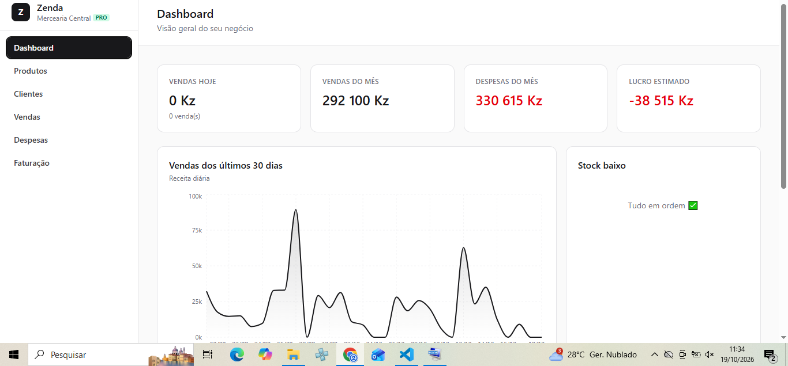
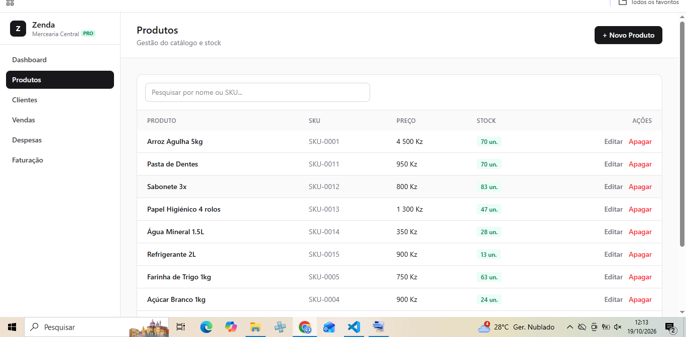
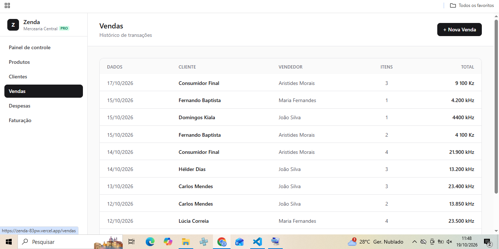
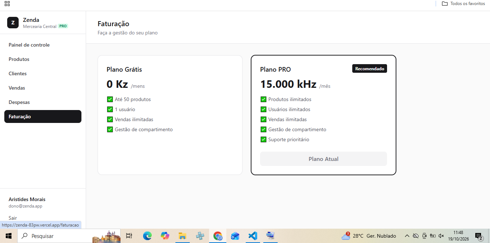

# Zenda - SaaS de Gestão para Pequenos Negócios

O Zenda é uma plataforma completa de gestão (SaaS) desenhada para pequenos negócios (mercearias, salões, restaurantes). Permite gerir produtos, stock, clientes, vendas e despesas num dashboard em tempo real.

## 🚀 Demo Online
- **Link de Acesso:** [https://zenda-83pw.vercel.app](https://zenda-83pw.vercel.app)
- **Credenciais de teste:** 
  - **Email:** `dono@zenda.app`
  - **Password:** `password123`

## 📸 Screenshots

### Dashboard (KPIs e Gráficos)

### Gestão de Produtos

### Registo de Vendas

### Faturação (Paywall)

## 🛠️ Stack Tecnológica
- **Frontend:** React, Vite, TypeScript, TailwindCSS, Recharts
- **Backend:** Node.js, Express, TypeScript, Zod
- **Base de Dados:** PostgreSQL (Neon), Prisma ORM
- **Infraestrutura:** Vercel (Frontend) e Render (Backend)

## ✨ Funcionalidades Principais
- Autenticação segura com JWT e Refresh Tokens (cookies httpOnly).
- Arquitetura Multi-tenant (cada empresa vê apenas os seus dados).
- Dashboard com KPIs em tempo real e gráficos de vendas.
- Registo de vendas com baixa automática de stock (Transações SQL).
- Simulação de Faturação (Plano Free com limite de 50 produtos vs Plano PRO ilimitado).

## 💻 Como correr localmente
1. Clone o repositório.
2. Instale as dependências: `pnpm install`
3. Suba o banco de dados local: `pnpm db:up`
4. Configure o `.env` baseando-se no `.env.example`.
5. Corra as migrações: `pnpm --filter @zenda/api exec prisma migrate dev`
6. Arranque o projeto: `pnpm dev`
